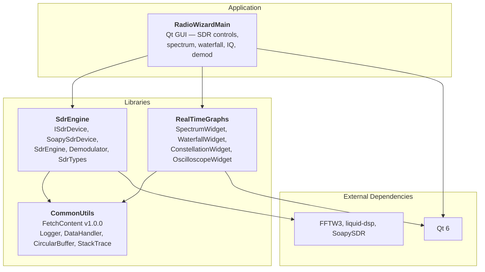

# Project Design

Architecture and design decisions for RadioWizard.

## Overview

RadioWizard is a C++20 application for Software Defined Radio (SDR) control,
spectrum and I/Q observation, signal isolation, and demodulation. It captures
RF data from SoapySDR-compatible hardware and visualizes it in real time.

## Architecture

## Modules

### SdrEngine (`source/SdrEngine/`)

Qt-free SDR device abstraction and DSP pipeline. Uses `DataHandler`
(CommonUtils) to publish spectrum and I/Q to consumers.

**Public API** (`include/SdrEngine/`):

- **SdrEngine** — orchestrates device streaming, FFT, channel filtering, and
  DataHandler publication; also `decimateSpectrum`, `enumerateSoapyDevices`,
  `createSoapyDevice`
- **ISdrDevice** — hardware abstraction interface
- **Demodulator** — FM mono/stereo and AM demodulation (liquid-dsp)
- **SdrTypes** — `IqSample`, `IqBuffer`, `SpectrumData`, window functions

**Private** (`src/`): `SoapySdrDevice`, `FftProcessor`, `ChannelFilter`

### RealTimeGraphs (`source/RealTimeGraphs/`)

Custom QPainter-based widgets for real-time visualization.

**Public API** (`include/RealTimeGraphs/`):

- SpectrumWidget, WaterfallWidget, ConstellationWidget, OscilloscopeWidget
- PlotWidgetBase (plus `colorPaletteCount` / `colorPaletteName`)

**Private** (`src/`): ColorMap, BandwidthSelector, PlotCursorOverlay,
ColorBarWidget, CommonGuiUtils, PlotPainterUtils

### RadioWizardMain (`source/RadioWizardMain/`)

Qt application hosting SDR controls, linked displays, bandwidth cursor /
channel filter, and demodulation with audio output. App-private headers live
under `src/` (not a reusable library).

### CommonUtils

Fetched via CMake FetchContent from
[festensoft/CommonUtils](https://github.com/festensoft/CommonUtils) at tag
`v1.0.0`. Provides `LoggerMacros.h` (`GPINFO`, …), `DataHandler`,
`CircularBuffer`, and `StackTrace`. spdlog is a private dependency of
CommonUtils (found on the system or fetched).

## Design decisions

- **Layout**: OmniscopeDDS-style modules with `include/<Module>/` public
  headers and `src/` for everything else; tests colocated under each module.
- **Static libraries**: SdrEngine and RealTimeGraphs are built as `STATIC`
  libraries for simpler deployment of a single GUI binary.
- **Conan** manages Qt, FFTW3, liquid-dsp, and GTest. SoapySDR remains a
  system package. CommonUtils (and spdlog via CommonUtils) are not Conan deps.
- **Logging**: `std::format`-based macros from CommonUtils; no project-local
  logger.
